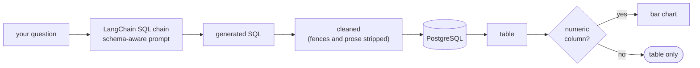

<p align="center">
  
</p>

<p align="center">
  <b>Ask your database a question in English. Get the SQL, the table and the chart.</b><br>
  <sub>A text-to-SQL business intelligence tool: a chat interface in front of PostgreSQL, with every generated query shown, not hidden.</sub>
</p>

<p align="center">
  <sub>
    <a href="#overview">OVERVIEW</a> &nbsp;·&nbsp;
    <a href="#quick-start">QUICK START</a> &nbsp;·&nbsp;
    <a href="#what-happens-to-a-question">WHAT HAPPENS TO A QUESTION</a> &nbsp;·&nbsp;
    <a href="#run-it">RUN IT</a> &nbsp;·&nbsp;
    <a href="#configuration">CONFIGURATION</a> &nbsp;·&nbsp;
    <a href="#layout">LAYOUT</a>
  </sub>
</p>

<br>

<table>
  <tr>
    <td><sub>INTERFACE</sub><br><b>Streamlit chat</b></td>
    <td><sub>TRANSLATION</sub><br><b>LangChain SQL chain</b></td>
    <td><sub>MODEL</sub><br><b>OpenAI, configurable</b></td>
    <td><sub>DATABASE</sub><br><b>PostgreSQL, Chinook sample</b></td>
  </tr>
</table>

## Overview

Query puts a chat box in front of a PostgreSQL database. Ask a question in plain English and it writes the SQL, runs it, shows the table, and draws a chart when there is something to plot.

The generated SQL is always shown under the answer, so you can check exactly what was asked of your data.

> [!TIP]
> `python test_brain.py` runs one question end to end through the chain and the database, a quick way to confirm your setup.

## Quick start

```bash
pip install -r requirements.txt
docker-compose up -d       # Postgres; import chinook.sql
streamlit run app.py       # http://localhost:8501
```


## What happens to a question

> What are the top 5 selling tracks?



1. The question goes to a LangChain SQL chain that knows the database schema.
2. The model's answer is cleaned down to a single runnable statement.
3. The statement runs against PostgreSQL.
4. The result comes back as a table, and as a bar chart whenever it has something numeric to plot.
5. The generated SQL sits in an expandable panel under every answer, so you can check what was actually asked of your data.

The conversation is kept for the session, and the database connection and chain are cached at module level, so only the first question pays the setup cost.

## Run it

Python 3.10+, PostgreSQL (Docker Compose is included), and an OpenAI API key.

```bash
pip install -r requirements.txt
docker-compose up -d          # Postgres; import chinook.sql into it
streamlit run app.py          # http://localhost:8501
```

```bash
python test_brain.py          # end-to-end check: one question through the chain and the database
```

## Configuration

Everything comes from environment variables, read from `.env`.

| Variable | Default | |
|---|---|---|
| `OPENAI_API_KEY` | | required |
| `OPENAI_MODEL` | `gpt-3.5-turbo` | any chat model |
| `OPENAI_TEMPERATURE` | `0` | deterministic SQL |
| `POSTGRES_HOST` / `POSTGRES_PORT` | `localhost` / `5432` | |
| `POSTGRES_DB` | `chinook` | |
| `POSTGRES_USER` / `POSTGRES_PASSWORD` | `admin` / `password123` | local defaults only |

<details>
<summary><b>Troubleshooting</b></summary>
<br>

| Symptom | Check |
|---|---|
| Cannot connect | Postgres is running, and the `.env` credentials match it |
| Empty answers | `chinook.sql` was actually imported into the `chinook` database |
| Model errors | `OPENAI_API_KEY` is set and the account has credit |
| Import errors | `pip install -r requirements.txt` on Python 3.10+ |

</details>

## Layout

```
app.py                  Streamlit chat interface
backend/
  db_chain.py           cached database connection and LangChain SQL chain
  data_processor.py     SQL cleaning, result parsing, chart creation
  config.py             environment configuration
  logger.py, constants.py
chinook.sql             the sample database
docker-compose.yml      local PostgreSQL
test_brain.py           end-to-end smoke test
```

<sub>The Chinook sample database is MIT licensed.</sub>
